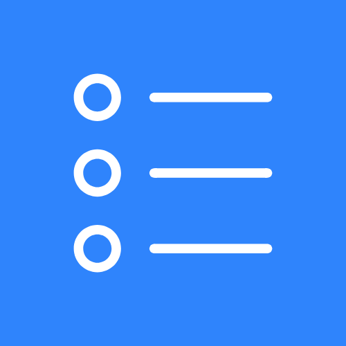

<p align="center">
  
</p>

<h1 align="center">DesktopTasks</h1>

<p align="center">
  Your Google Tasks, pinned to the Windows desktop as a frameless widget.
</p>

Sibling project to [DesktopCards](https://github.com/AaryanPanigrahi/DesktopCards),
which does the same thing for bank balances. The widget architecture here
follows it closely.

## Status

Early, but it runs. The whole loop works: sign in to Google, fetch, and a
frameless window pinned to the desktop that sizes itself to your task list.

It builds to a single `.exe` too (see [Building the exe](#building-the-exe)),
though no release has been published yet -- so for now this runs from
source, which needs a Google OAuth client of your own. See
[Running from a clone](#running-from-a-clone).

## What it looks like

A borderless card sitting on the wallpaper, behind your desktop icons:

- **Pinned.** It survives Win+D (Show Desktop) and never appears in the
  taskbar or in Alt+Tab, because it is parented onto the desktop's own
  paint layer rather than floating above it.
- **Read-only, and that is deliberate.** That desktop layer receives no
  mouse input at all -- the same reason Rainmeter and Wallpaper Engine
  skins need a system-wide hook to be clickable. So there is nothing to
  click, and no checkboxes: a control you could see but never press would
  be worse than none. Everything you can do lives in the tray icon.
- **Sized to its content.** The window grows and shrinks with the number
  of tasks rather than scrolling or cutting the last one off.

It shows your task lists with subtasks nested under their parents, due
dates (with overdue and today called out), and notes. A list with nothing
open says "All clear" rather than looking broken.

## Tray icon

The widget's only control surface. Right-click it:

| Item | What it does |
|---|---|
| **Reload** | Re-fetch from Google now, and re-read your settings |
| **Reconnect Google** | Sign in again. See [the 7-day thing](#the-7-day-reconnect) |
| **Restart** | Relaunch, for settings only read at startup (window position, pinning) |
| **Quit** | Close the widget |

## Quick start

```
cp config/config.example.json config/config.json   # defaults are fine

python source/google_tasks_setup.py                # sign in to Google
python source/desktoptasks.py                      # run the widget
```

`desktoptasks.py` is the only entry point; everything else is a flag on it:

```
python source/desktoptasks.py            # the widget
python source/desktoptasks.py --fetch    # one fetch, then exit
python source/desktoptasks.py --connect  # sign in to Google
python source/desktoptasks.py --serve    # just the HTTP server
python source/desktoptasks.py --help
```

`--serve` is the way to work on the page in an ordinary browser tab,
without the window in the way.

Signing in opens Google's consent page in your browser. An **"unverified
app"** warning is expected -- the app is not through Google's verification
review. Click **Advanced > Go to DesktopTasks (unsafe)**.

## The 7-day reconnect

**Google expires the sign-in every 7 days, so you will need to click
Reconnect Google in the tray about once a week.**

This is not a bug and not something the code can fix. The Cloud project
behind the app is in Google's "Testing" publishing status, and Google
issues short-lived refresh tokens to apps in that state. When it lapses,
the widget does not go blank: it keeps showing the last tasks it fetched
and adds a note telling you to reconnect.

Getting rid of it means publishing the project to production, which Google
gates behind a homepage, a privacy policy and a terms-of-service URL, all
on a domain verified in Search Console. That is the one outstanding reason
to go buy a domain. Nothing in the code changes when it happens.

The same status is why a stranger cannot currently use a build of this:
apps in Testing admit only accounts on an explicit test-user list.

## Settings

Everything lives in `config/config.json`. Copy it from
`config.example.json`; every key has a sane default, so a missing file
still runs.

| Key | Default | What it does |
|---|---|---|
| `fetch_interval_minutes` | `15` | How often to re-fetch |
| `show_notes` | `true` | Show task notes under the title |
| `group_by_list` | `true` | One card per task list, or everything in one |
| `show_completed` | `false` | Include completed tasks |
| `tasklist_ids` | `[]` | Empty means every list; narrow it to pick |
| `port` | `5100` | Local HTTP port the page is served on |
| `window.x` / `window.y` | `100` | Where the widget sits |
| `window.corner_radius` | `16` | Rounded-corner radius, in pixels |
| `window.survive_show_desktop` | `true` | Pin it (see above). `false` makes it an ordinary floating window |
| `window.dark_theme` | `true` | Dark or light palette |
| `window.accent` | `null` | Accent colour; `null` uses your Windows accent |

Most changes take effect on the next **Reload**. The window ones
(`x`, `y`, `survive_show_desktop`) need a **Restart**, since they are only
read at startup.

`refresh_token` is written for you when you sign in. Keep it to yourself:
it grants read access to your tasks.

## Running from a clone

A clone needs a Google OAuth client of its own. Release builds will bundle
one, but it is deliberately not committed to this repo.

1. Copy `source/oauth_client.example.py` to `source/oauth_client.py`. Its
   docstring walks through the rest.
2. In the [Cloud console](https://console.cloud.google.com/): enable the
   **Tasks API** (not *Cloud Tasks*, an unrelated job-queue product), set
   up an OAuth consent screen as **External**, and create an OAuth client
   of type **Desktop app**. The desktop type is required, not a
   preference -- it is the only kind Google lets redirect to a loopback
   port that was not registered in advance.
3. Add your own Google account to the consent screen's **test users**, or
   sign-in will be refused before it starts.
4. Either paste the client into `oauth_client.py`, or pass Google's
   downloaded JSON straight to the setup script:

```
python source/google_tasks_setup.py client_secret.json
```

`client_id` / `client_secret` in `config/config.json` override everything
else, if you would rather keep them there.

## Building the exe

Not needed to run it; this is how a release is produced.

```
pip install pyinstaller
python source/build.py
```

That regenerates the icon from `logo.png`, runs a preflight, and writes
`dist/DesktopTasks.exe` -- one file carrying Python and every dependency,
so it runs on a machine with no Python. The exe is unsigned, so its first
run trips SmartScreen (**More info > Run anyway**).

The preflight exists for one reason: `source/oauth_client.py` is
gitignored, and the app treats it as optional at runtime so that a clone
still works. Together that means a build on a machine without it would
succeed and produce an exe that launches, looks right, and then tells
every user that no client is configured. `build.py` refuses to build in
that state rather than letting it ship.

## Layout

```
source/     all code; dashboard.html + dashboard.js are the page
config/     your settings and credentials, in one config.json
            config.example.json is tracked; what you copy it into is not
Docs/       notes and design docs
logo.png    the app's mark -- the exe icon and the tray icon both derive
            from it, so replacing it changes both
```

Nothing secret is tracked: `config/config.json` and
`source/oauth_client.py` are both gitignored.

## Privacy

Your tasks are read from Google and written to `config/tasks.json` on your
own machine. Nothing is sent anywhere else. The local HTTP server binds
`127.0.0.1` only, refuses any request whose `Host` header does not name
this machine, and never serves `config.json`.
