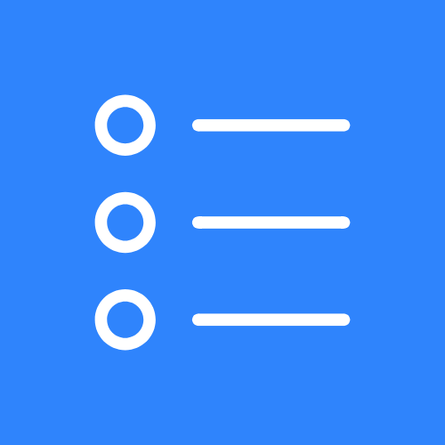

# DesktopTasks

A small desktop widget that shows your Google Tasks at a glance, pinned to a
corner of your screen. It can start with Windows, keeps itself up to date,
stays put when you press Win+D, and never appears in the taskbar or in
Alt+Tab.



Each task list is a card: open tasks with their subtasks nested underneath,
notes, and due dates read the way a person would say them. *Today*,
*Tomorrow*, then *Oct 20*, with overdue and today picked out in colour. A
list with nothing open says **All clear** rather than looking broken.

It is read-only, and that is deliberate. The desktop layer a pinned window
lives on receives no mouse input at all, so a checkbox you could see but
never tick would be worse than none. Everything you can change lives in the
tray icon and the settings page.

### Supports

- Light/Dark theme, and an accent colour
- Translucency and opacity
- Several columns, with the lists dealt across them in an order you drag
- 'Survive' show desktop (Win + D) toggle
- Rounded corners, scale, and custom spacing
- Column width, a height cap, and a limit on how many tasks are drawn
- Picking which task lists show, without forgetting the ones you unpick
- Lists of its own: Due today, Overdue, Due this week, Due in order,
  No due date
- Several Google accounts, with a switcher
- Starting with Windows, and Start-menu or desktop shortcuts

All of it changes from a settings page in your browser.

### Before you start

You need a Google account, and that is all. No API billing, no keys to buy.
Signing in opens Google's own consent page, where DesktopTasks asks only to
**see** your tasks and your email address. It cannot change anything.

**Google will call it an unverified app.** Choose *Advanced → Go to
DesktopTasks (unsafe)*. The Cloud project behind it is in Google's *Testing*
publishing status, which costs you two things:

- **The sign-in expires every 7 days,** so about once a week the widget asks
  you to reconnect. It does not go blank when that happens. It keeps showing
  the last tasks it fetched and adds a note.
- **Only accounts on the project's test-user list can sign in,** which is why
  running this today means using a Cloud project of your own.

Neither ends until the project is published to production, which Google
gates behind a verified domain.
[Details in the docs](Docs/README.md#testing-status-and-the-two-things-it-costs).

**All information is only saved _locally_.** Your tasks and your Google
token stay in files on your own computer. The widget runs a small background
server so the settings page can load, but only this computer can reach it. It
binds `127.0.0.1`, refuses any request that does not name this machine, and
never serves the file holding your token. Your Google password is only ever
typed on Google's own page.

## Getting started

First, a Google OAuth client of your own. A release would bundle one, but it
is deliberately not committed here, so every clone brings its own.

In the [Cloud console](https://console.cloud.google.com/): enable the **Tasks
API**, set up an OAuth consent screen as **External**, add your own Google
account under **test users**, and create an OAuth client of type **Desktop
app**. Copy `source/oauth_client.example.py` to `source/oauth_client.py` and
paste the client in, or hand Google's downloaded JSON to `--connect` below.
[The long version](Docs/README.md#cloud-console-configuration), including
why the Desktop type is required rather than preferred.

Then, two ways to run it:

**1) As an installed app**

No release has been published yet, so you build the installer once:

```
pip install -r requirements.txt
pip install pyinstaller
python source/build.py
```

That writes `dist/DesktopTasks.exe` and `dist/DesktopTasks-Setup.exe` beside
it, single files carrying Python and every dependency. Run
**DesktopTasks-Setup.exe**: one dialog, one tick box for *start with
Windows*, and it installs to `%LOCALAPPDATA%\DesktopTasks`, puts the app in
your Start menu and launches it. Windows will warn you it isn't signed:
choose *More info*, then *Run anyway*. Nothing needs administrator and
nothing is installed system-wide.

Connect your Google account from the tray icon, the same as from source.

Those two files are the same binary, byte for byte. The **filename** is what
picks what it does, which is why setup needs nothing of its own and cannot
fall out of step with the app it installs. Setup writes a third copy of it as
`Uninstall.exe`. From an installed copy, `DesktopTasks.exe --setup` and
`--uninstall` do the same two jobs.

So a release is one file: `DesktopTasks-Setup.exe`. The other two are what an
install produces, not things to download.

**2) From Python**

```
pip install -r requirements.txt
python source/desktoptasks.py --connect     # sign in to Google
pythonw source/desktoptasks.py              # run the widget
```

`--connect client_secret.json` passes Google's downloaded JSON in directly.
`desktoptasks.py` is the only entry point and every mode is a flag on it:
`--fetch` for one pull then exit, `--serve` for just the HTTP server, which
is how to work on the page in an ordinary browser tab, `--setup` and
`--uninstall`, and `--help`.

## Changing things

Right-click the tray icon and choose **Modify** for three tabs: **Account**
to sign in, switch between Google accounts and pick which task lists show,
**Layout** for columns and the order lists are dealt in, and **Appearance**
for the look, the window, and the Windows shortcuts. The tray also has
**Reload** (fetch now), **Restart** and **Quit**.

Saving applies to the widget straight away. A few settings are only read when
the window is created, which is position, corner radius, pinning and
translucency. The page says so on each of them, and **Restart widget** at the
bottom applies them.

The three shortcut switches are files rather than settings, so they are
written on **Save** or by **Redo shortcuts**, and never as you click them.
Reach for Redo when a shortcut exists but points somewhere stale, such as
after moving your checkout.

Two files hold everything, if you would rather edit by hand:
`config.json` for the Google account and the fetch, `appearance.json` for how
the widget looks. The second has no secrets in it and holds a few things the
settings page deliberately does not show, which are the widget's colours and
its text sizing and spacing. [`Docs/README.md`](Docs/README.md) lists every
key in both.

## Uninstalling

`Uninstall.exe` sits next to the app in `%LOCALAPPDATA%\DesktopTasks\`, and
DesktopTasks is listed in **Settings → Apps**, so either route works. It
confirms first, with **Keep my settings and my signed-in account** ticked.
Leave it ticked and your account, your task-list selection and your
appearance survive for a reinstall. Clear it and the folder goes.

Your tasks are untouched either way. They live in your Google account, this
app only ever read them, and the token it removes is a local file, so
uninstalling signs this computer out and nothing more. From a checkout:
`python source/desktoptasks.py --uninstall`.

## What's in this repo

| | |
|---|---|
| `source/` | The code: the widget, the server, the page, the settings page, setup and uninstall |
| `config/` | Example settings. Your real ones are made on first run and stay on your machine |
| `Docs/` | The full write-up, plus the privacy policy and terms |
| `site/` | The small public site those two are published from |
| `logo.png` | The app's mark. The exe icon and the tray icon both derive from it |

Nothing secret is tracked: `config/config.json`, `config/appearance.json`
and `source/oauth_client.py` are all gitignored.

[`Docs/README.md`](Docs/README.md) is the long version: every setting, how
refreshing works, how the pinned window is done, how installing works, and
why things are built the way they are.
